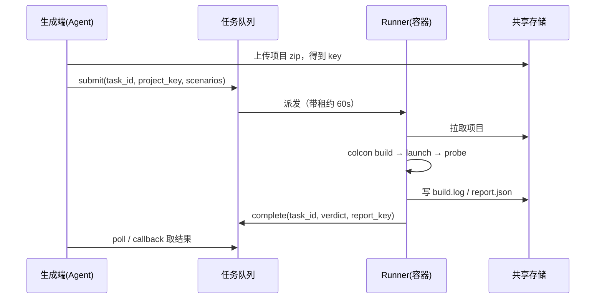

# 方案 B：真 ROS（容器内真实运行）

> 定位：**终审**。只有这一层判 `pass` 才作数。
> 关联：[总览](./00-overview.md) · [方案 A](./01-scheme-a-fake-ros.md) · [方案 C](./03-scheme-c-hybrid.md)

---

## 1. 一句话

把生成的 ROS2 包放进一个**固定镜像的容器**里，真 `colcon build`、真起节点、真跑探针，返回结构化结果。

---

## 2. 硬约束：装不进当前进程

当前应用是托管环境里的**单端口 Python 进程**（无 root、不能 `apt install`）。ROS 2 Jazzy 需要 Ubuntu 24.04 基础 + 1.5–3 GB 依赖，**无法就地安装**。

只有三条路：

| 方案 | 说明 | 适合 |
|---|---|---|
| 本机 / 自建服务器 Docker | 自己控制，成本最低 | 内部使用、有服务器 |
| 托管沙箱（E2B / Modal / Daytona） | 自带 VM 与镜像能力，按秒计费 | 不想运维 |
| 云主机 + docker compose | 一台 4C8G 起步 | 长期稳定跑 |

---

## 3. 架构与时序（必须异步）



**关键设计**

- **异步**：`colcon build` 1–5 分钟，同步接口必超时；
- **租约**：worker 心跳续租，超时未续则任务回队（连接断了任务不能丢）；
- **幂等键**：`project_hash + 场景 + 镜像 digest`，防重复执行；
- **只传引用**：项目 zip、日志、报告走共享存储，消息体只放 key。

---

## 4. 镜像设计（决定可复现性）

### 4.1 分层

```dockerfile
# base：ROS 基础，几乎不变
FROM ros:jazzy-ros-base AS base

# common：常用包，季度更新
FROM base AS common
RUN apt-get update && apt-get install -y --no-install-recommends \
      ros-jazzy-sensor-msgs ros-jazzy-nav-msgs ros-jazzy-geometry-msgs \
      ros-jazzy-std-srvs ros-jazzy-tf2-ros ros-jazzy-xacro \
      ros-jazzy-ros2bag ros-jazzy-rviz2 \
    && rm -rf /var/lib/apt/lists/*

# runner：测试工具链
FROM common AS runner
COPY runner/ /opt/runner/
ENV ROS_DISTRO=jazzy
ENTRYPOINT ["python3", "/opt/runner/main.py"]
```

### 4.2 铁律

1. **固定 digest**：`ros2test/runner@sha256:...`，报告里记录；
2. **补录产出新 tag**：`2026-11`、`2026-12`，**旧 tag 永久冻结**；
3. **装包只发生在 build 阶段**，运行阶段永久断网；
4. **缺包只报不装**，返回 `missing_dependency` 让生成端改 `package.xml`。

---

## 5. 执行流程

```bash
# 1. 准备（受限目录）
mkdir -p /work/src && cp -r /input/src/* /work/src/

# 2. 依赖预检（不装，只查）
python3 /opt/runner/precheck.py /work          # 输出 missing_dependency

# 3. 构建
cd /work && source /opt/ros/jazzy/setup.bash
timeout 300 colcon build --symlink-install 2>&1 | tee build.log

# 4. 起节点
source install/setup.bash
timeout 30 ros2 launch <pkg> <launch.py> > run.log 2>&1 &
LAUNCH_PID=$!
sleep 2                                        # DDS 发现预热，不计入判定

# 5. 探针
ros2 topic list -t                             > probe.txt
ros2 topic info /scan -v                       >> probe.txt
timeout 5 ros2 topic hz /scan --window 10 \
        --qos-reliability best_effort          >> probe.txt
ros2 node list                                 >> probe.txt

# 6. 清理（必须）
kill -TERM $LAUNCH_PID; sleep 1; pkill -9 -f ros2 || true
```

---

## 6. 探针设计

| 探针 | 命令 | 证明 |
|---|---|---|
| 话题存在性 | `ros2 topic list -t` | 话题名 + 类型 |
| 端点数量 | `ros2 topic info /scan -v` | 几个 pub / sub、QoS 是什么 |
| 数据流速 | `ros2 topic hz /scan` | **真的有数据在流**（它自己就是订阅者） |
| 节点存活 | `ros2 node list` | 节点起来了 |
| 声明核对 | `ros2 node info /lidar_node` | 声明的 pub/sub 与静态分析是否一致 |

### 6.1 QoS 是最大的坑

- 发布者 `best_effort` + 订阅者 `reliable` → **不兼容，一条都收不到**；
- `ros2 topic hz` 默认用 `reliable` 订阅 → 对 `best_effort` 发布者会**显示无数据**，看起来像"断了"；
- 探针统一加 `--qos-reliability best_effort`（兼容性最好）；
- 收 latched 数据（map、静态 TF）必须 `--qos-durability transient_local`。

---

## 7. 判定：三态 + 六条假失败防护

### 7.1 三态

```
pass     探针观测到，且与声明一致
fail     观测到，且明确不符（类型不同、pub/sub 数量为 0、频率为 0）
unknown  未观测到（超时、一次性消息、探针 QoS 不兼容）
```

### 7.2 六条防护（不做就会满屏假失败）

| 来源 | 防护 |
|---|---|
| 命名空间 / remap | 比对前展开全名（`ns + remap`），禁止比原始字符串 |
| 低频话题 | 窗口 `= max(3s, 3 × 周期)` |
| DDS 发现延迟 | 先起探针再起节点；预热 1–2s 不计入 |
| 一次性消息 | 要求 `transient_local`，或调整启动顺序 |
| `hz` QoS 不兼容 | 显式 `--qos-reliability best_effort` |
| 并发干扰 | 每任务独立 `ROS_DOMAIN_ID` + 独立工作区 |

---

## 8. 报告示例

```json
{
  "schema": "ros2test/v1",
  "mode": "container",
  "stage": "connectivity",
  "verdict": "fail",
  "duration_ms": 84210,
  "checks": [
    { "id": "build.ok", "status": "passed", "detail": "colcon build 成功，耗时 61s" },
    { "id": "node.alive", "status": "passed", "detail": "2 个节点在运行" },
    { "id": "topic.qos_incompatible", "status": "failed", "severity": "error",
      "subject": "/scan",
      "detail": "发布者 best_effort，订阅者 reliable，不兼容",
      "expected": "两端 QoS 一致或订阅端 best_effort",
      "actual": "reliable <-> best_effort" },
    { "id": "topic.orphan_publisher", "status": "unknown", "severity": "info",
      "subject": "/cmd_vel", "detail": "无订阅者（可能是外部接口）" }
  ],
  "artifacts": {
    "build_log": "logs/t_8f2a/build.log",
    "run_log": "logs/t_8f2a/run.log",
    "probe": "logs/t_8f2a/probe.txt"
  },
  "env": { "image_digest": "sha256:9c1f...", "ros_distro": "jazzy" }
}
```

---

## 9. 资源与成本

| 项 | 建议 | 说明 |
|---|---|---|
| 机器 | 4C8G / 100G SSD | `ros-base` + 常用包镜像约 2 GB |
| 并发 | 2–4 个容器 | `colcon build` 吃满 CPU |
| 单次耗时 | 1–5 分钟 | 取决于包数量与并行度 |
| 磁盘 | 镜像 + 构建产物 + 日志，按月清理 | 日志保留 7 天 |

---

## 10. 安全（对外开放前必须做）

| 措施 | 说明 |
|---|---|
| `--network none` | 运行阶段完全断网，防数据外泄与 LLM 拉取 |
| `--read-only` + tmpfs | 根文件系统只读，只有 `/work` 与 `/tmp` 可写 |
| `--cap-drop ALL` | 去掉所有 Linux capability |
| 非 root 用户 | 容器内不要用 root 跑 |
| **gVisor（`--runtime=runsc`）** | 执行的是 LLM 生成的代码，容器隔离不足以防逃逸 |
| 独立 `ROS_DOMAIN_ID` | 防并发互相干扰 |
| 不放任何密钥 | 测试容器里不要有 DashScope Key |

> **注意**：README 里已明确写过"这是编译校验沙箱，不是安全隔离层"。对外开放前必须补 gVisor 或一次性 VM。

---

## 11. 里程碑

| 阶段 | 内容 | 验收 | 人日 |
|---|---|---|---|
| M1 | Dockerfile + 手动 `docker run` 跑通一个 demo 包 | 能 build 能起节点 | 1–2 |
| M2 | Runner 脚本（build → launch → probe → 清理） | 输出标准 report.json | 2 |
| M3 | 异步任务队列 + 租约 + 幂等 | 断连不丢任务 | 2 |
| M4 | 六条假失败防护 + 三态 | 同一项目连跑 5 次结论一致 | 1–2 |
| M5 | 接入 `sandbox.py` 的 `docker` 后端 | 前端可选择后端 | 1 |

---

## 12. 验收标准

1. 一个真实 ROS2 项目能完成 build → 起节点 → 探针 → 报告全流程；
2. 同一份代码连跑 5 次，`verdict` 一致（可复现）；
3. 断网、只读根、非 root 下运行成功；
4. 缺包时返回 `missing_dependency` 而非 `build_failed`；
5. 报告与方案 A 共用 schema，仅 `mode` / `stage` 不同。
