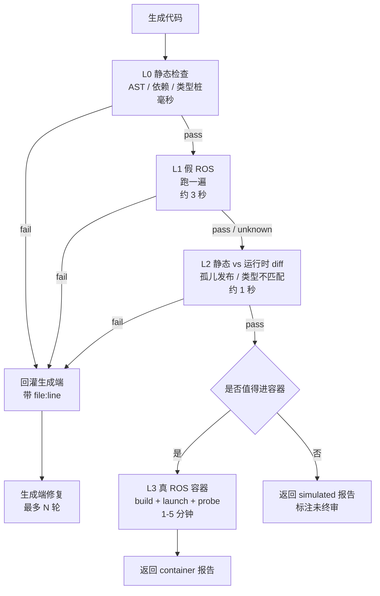

# 方案 C：真假混合（推荐）

> 定位：**串联闸门**。假 ROS 快速淘汰，真 ROS 最终盖章。
> 关联：[总览](./00-overview.md) · [方案 A](./01-scheme-a-fake-ros.md) · [方案 B](./02-scheme-b-real-ros.md)

---

## 1. 为什么必须串起来

两层判定的**可信方向是相反的**：

```
sim 判 fail   → 可信（Python 崩了，无环境因素）
sim 判 pass   → 不可信（假环境不代表真环境）

真 ROS 判 pass → 可信（真跑通了）
真 ROS 判 fail → 不可信（可能是环境/时序问题）
```

所以：

- 只用 A：会有"假通过"——学生拿着 ✅ 上真机，一样撞墙；
- 只用 B：学生要等 5 分钟才知道"少写了一个括号"，体验崩坏，且容器排队压力大。

**A 负责"快"，B 负责"准"，中间靠短路规则连起来。**

---

## 2. 三级流程



### 2.1 短路规则（核心）

| 条件 | 动作 |
|---|---|
| L0 / L1 / L2 任一 `fail` | **不进容器**，直接回灌（省下 1–5 分钟） |
| L1 全 `pass` 且项目包含 C++ 或自定义 msg | **必须进容器**（sim 覆盖不了） |
| L1 全 `pass` 且只有 Python 节点 | 可配置：默认进容器终审；高负载时降级为"仅 sim + 标记未终审" |
| 用户显式要求"真机验证" | 无条件进容器 |

### 2.2 结果合并

一次任务可能产生两份报告（sim + container）。合并规则：

```
container 存在        → 以 container 为准，sim 报告作为上下文附上
只有 sim 且全 pass    → verdict = unknown（未终审），UI 用黄色
只有 sim 且存在 fail  → verdict = fail
```

---

## 3. 统一契约

三套后端共用同一份 schema，**只有 `mode` 和 `stage` 不同**。

```json
{
  "schema": "ros2test/v1",
  "task_id": "t_8f2a",
  "mode": "simulated | container",
  "stage": "static | run | connectivity | build",
  "verdict": "pass | fail | unknown",
  "finalized": false,
  "checks": [],
  "failure": {},
  "artifacts": {},
  "env": {}
}
```

新增字段 `finalized`：区分"sim 通过但未终审"和"真机通过"。

### 3.1 前端呈现

| 状态 | 颜色 | 文案 |
|---|---|---|
| `pass` + `finalized=true` | 绿 | 真机验证通过 |
| `pass` + `finalized=false` | 黄 | 逻辑检查通过，尚未真机验证 |
| `fail` | 红 | 定位到 file:line + hint |
| `unknown` | 灰 | 未观测到，附原因 |

---

## 4. 成本模型

假设每天 200 次生成任务：

| 环节 | 次数 | 单次耗时 | 合计 |
|---|---|---|---|
| L0 静态 | 200 | 50 ms | 10 s |
| L1 假 ROS | 200 | 3 s | 10 min |
| L2 diff | 130（70% 通过 L1） | 1 s | 2 min |
| L3 容器 | 40（约 30% 进入） | 3 min | 2 h（并发 4 → 30 min 墙钟） |

**结论：90% 的任务在 5 秒内拿到结果，容器只承接 10–30%。** 这就是混合方案的全部价值。

---

## 5. 一致性校验（防 mock 漂移）

假 ROS 最大的风险是"sim 绿、真机红"。必须有机制发现：

### 5.1 抽样对照

```
每周随机抽 N 个任务，对比：
  sim_verdict 与 container_verdict
统计：
  假绿率 = sim pass 且 container fail 的比例
  假红率 = sim fail 且 container pass 的比例
阈值：假绿率 > 5% → 冻结 sim 放行权，回退为"仅作提示"
```

### 5.2 反哺

每一条"假绿"，都要落成一条新规则或一条修正：

| 假绿原因 | 反哺动作 |
|---|---|
| sim 不校验 QoS | 在 sim 里加"声明 QoS 一致性"静态检查 |
| sim 消息类字段过宽 | 收紧 dataclass 定义 |
| sim 未模拟异步 | 在报告里显式标注"未覆盖时序" |

---

## 6. 编排要求

| 项 | 要求 |
|---|---|
| 队列 | Redis Stream / RabbitMQ（自带 ack、重投、消费组） |
| 状态机 | `queued → running → done / failed / timeout / cancelled` |
| 租约 | worker 领任务 60s，心跳续租，超时回队 |
| 幂等 | `project_hash + scenario + image_digest` 作为 key |
| 文件 | 只传引用（对象存储/共享卷），消息体不放 zip |
| 可观测 | `trace_id` 从提交贯穿到报告 |
| 取消 | 用户可中途取消，容器内 `SIGTERM` 后 `pkill` |

---

## 7. 里程碑

| 阶段 | 内容 | 验收 | 人日 |
|---|---|---|---|
| P0 | 统一 schema + 三态 + `finalized` | 前端能渲染四种状态 | 1 |
| P1 | L0 + L1 串联（无容器） | 90% 任务 5 秒出结果 | 2 |
| P2 | L2 静态 vs 运行时 diff | 能报孤儿发布/类型不匹配 | 1–2 |
| P3 | L3 容器接入 + 短路规则 | 容器只承接 30% 以下任务 | 3–4 |
| P4 | 抽样一致性校验 + 指标看板 | 假绿率可见 | 1 |

---

## 8. 风险与对策

| 风险 | 影响 | 对策 |
|---|---|---|
| **假绿**（sim 放过了真错误） | 学生上真机撞墙 | 抽样对照 + 假绿率阈值 + 黄灯"未终审" |
| **假红**（容器环境问题误判代码） | 学生不停"修"对的代码 | 三态 `unknown` + 容器侧六条防护 |
| 编排复杂度上升 | 维护成本 | 先做 P0–P1，容器后置 |
| 两套规则漂移 | 报告不一致 | 规则写在同一个 `checks.py`，后端只负责采集 |
| 成本不可控 | 容器排队 | 短路规则 + 并发槽位 + 缓存（同 hash 复用结果） |

---

## 9. 验收标准

1. 同一份代码，sim 与 container 的 `checks[].id` **完全一致**（后端只换采集方式，不换规则）；
2. 90% 任务在 5 秒内返回结果（容器只承接少量）；
3. 报告带 `finalized` 字段，前端能区分"未终审通过"与"真机通过"；
4. 假绿率可统计，且超过 5% 时能自动降级；
5. 断连、重启后任务不丢（租约 + 幂等生效）。

---

## 10. 推荐落地顺序

```
第 1 周：P0 契约（schema + 三态 + finalized）+ 前端四种状态渲染
第 2 周：P1 假 ROS 最小版（12 包 + 6 消息 + 3 条检查）
第 3 周：P2 静态 vs 运行时 diff（graph.py 接总线）
第 4-5 周：P3 容器接入（镜像 + runner + 队列）
第 6 周：P4 抽样校验 + 指标
```

**如果只有 1 周时间**：只做 P0 + P1，就能覆盖 80% 的"跑不起来"，且零服务器成本。
